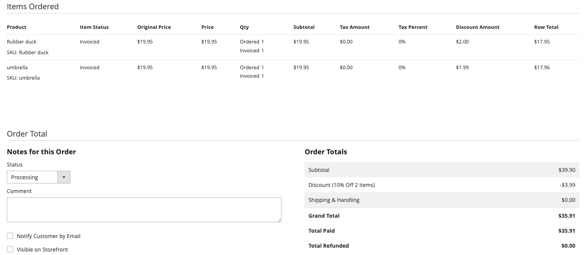

# Créer des règles de prix de panier

Les règles de prix de panier appliquent des remises aux articles du panier en fonction des conditions que vous avez définies. La remise peut s’appliquer automatiquement lorsque les conditions sont remplies ou lorsque le client saisit un code de coupon valide. La remise apparaît dans le panier sous le sous-total . Vous pouvez activer ou désactiver une règle pour une saison ou une promotion en modifiant son statut et sa période.

## À qui s&#39;adresse cette vidéo ?

* Spécialistes du marketing eCommerce
* Gestionnaires de site web

## Contenu vidéo

* Créez des règles de prix de panier et des codes de coupon facultatifs.
* Découvrez comment les remises apparaissent dans le panier et pour les promotions.

>[!VIDEO](https://video.tv.adobe.com/v/343835?learn=on)

## Problèmes d’affichage des prix

Dans certains cas, chaque ligne doit afficher la remise appliquée, mais les valeurs affichées peuvent ne pas correspondre exactement. Cela se produit lorsqu’une règle de prix de panier applique une remise à plusieurs produits et que la répartition n’est pas divisée de manière égale à deux décimales.

>[!BEGINSHADEBOX]

Règle de prix du panier = remise de 10 % appliquée à 2 produits du panier
Condition pour que la règle de prix prenne effet : le total des articles du panier est de 2
Les actions appliquent un pourcentage de remise sur le prix du produit et ce montant de remise est de 10

2 articles sont ajoutés au panier, chacun est de 19,95 $

Pour obtenir le montant de la remise, multipliez le prix du produit par 0,1

19,95 x 0,1 = 1,995

C&#39;est le problème, nous avons 3 décimales, au lieu de deux. Convertir cela en dollars est maintenant un problème

>[!ENDSHADEBOX]

### La solution

Pour le commerçant dans l&#39;Admin, l&#39;approche la plus claire est d&#39;afficher chaque ligne commandée avec sa remise en dollars. Pour que le total de la commande reste correct, arrondissez la première ligne vers le haut et déposez la troisième décimale sur les autres lignes. Examinez ce scénario :

>[!BEGINSHADEBOX]

Même remise de 10 % que la règle du panier ci-dessus en vigueur
Ajouter 2 produits au panier de 19,95

Chaque produit devrait bénéficier de remises de 1,995 $
Produit 1 - 19,95 x 0,1 = 1,995
2 - 19,95 x 0,1 = 1,995

Un total général de 3,99 est fourni à titre de remise au client

Lors de l’affichage des éléments de ligne au propriétaire du magasin dans l’administrateur,
nous devons ajuster le premier élément et l&#39;arrondir à 2 000. Pour le deuxième élément, supprimez la troisième décimale.
Produit 1 = 2,00
Produit 2 = 1,99

La remise totale des deux produits maintenant, lorsqu&#39;elle est additionnée, correspond à la remise réelle fournie à un client.
>[!ENDSHADEBOX]

Voici une capture d’écran qui s’afficherait dans l’administration pour une commande avec ce scénario :

### Autres solutions potentielles et raisons pour lesquelles elles n’ont pas été utilisées

>[!BEGINSHADEBOX]

Même remise de 10 % que la règle du panier ci-dessus en vigueur
Ajouter 2 produits au panier de 19,95

Chaque produit devrait obtenir 1,995 $ de rabais,
cependant, si nous les arrondissons, cela montre trop de réduction.

Produit 1 - 19,95 x 0,1 = 1,995
Produit 2 - 19,95 x 0,1 = 1,995

Convertir pour arrondir tous les éléments
Produit 1 La nouvelle valeur est 2.00
Produit 2 La nouvelle valeur est 2.00

Un total général de 3,99 a été effectivement fourni comme une remise au client,
toutefois, si nous arrondissons les chiffres, nous constatons que 4 $ ont été versés, ce qui est inexact.

2.00 + 2.00 = $4.00

>[!ENDSHADEBOX]

Problème similaire si la troisième décimale était supprimée pour tous les éléments, la remise fournie serait trop faible.

>[!BEGINSHADEBOX]

Même remise de 10 % que la règle du panier ci-dessus en vigueur
Ajouter 2 produits au panier de 19,95

Chaque produit devrait obtenir 1,995 $ de rabais, mais si nous laissons simplement tomber la troisième décimale, cela se produit :
Produit 1 - 19,95 x 0,1 = 1,995
Produit 2 - 19,95 x 0,1 = 1,995

Convertir pour supprimer la troisième décimale pour tous les éléments
Produit 1 Nouvelle valeur : 1,99.
Produit 2 La nouvelle valeur est 1,99

Un total général de 3,99 a été effectivement fourni comme une remise au client,
toutefois, si nous laissons tomber la troisième décimale, cela indiquera que 3,98 $ ont été versés, ce qui est inexact.

1.99 + 1.99 = $3.98

>[!ENDSHADEBOX]

## Ressources supplémentaires

* [Créer une règle de prix de panier - [!DNL Commerce] Guide de marchandisage et de promotion](https://experienceleague.adobe.com/docs/commerce-admin/marketing/promotions/cart-rules/price-rules-cart-create.html){target="_blank"}
* [Codes de coupon - [!DNL Commerce] Guide de merchandising et de promotion](https://experienceleague.adobe.com/docs/commerce-admin/marketing/promotions/cart-rules/price-rules-cart-coupon.html){target="_blank"}
